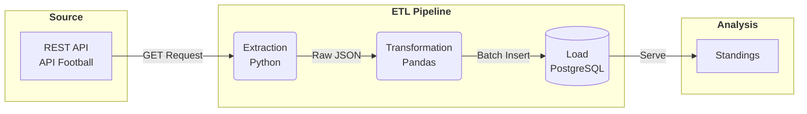

# Veikkausliiga Data Pipeline: REST API to PostgreSQL

A simple end-to-end ETL (Extract, Transform, Load) data pipeline built with Python and PostgreSQL. 
The pipeline extracts regular standings and club performance statistics for the Finnish top-tier football league 
(**Veikkausliiga**, League ID: `244`) for the **2024 season** from API-Football, cleans and normalizes the nested JSON payload, 
and loads the structured data into a PostgreSQL relational database using batch insertion.

---

## Architecture



---

## Pipeline Workflow

### 1. Extract
- **Source:** API-Football REST API (`v3.football.api-sports.io`)
- **Endpoint:** `/standings`
- **Parameters:** `league=244`, `season=2024`
- **Security:** API access tokens and database credentials are held in an untracked `.env` configuration file managed by `python-dotenv`.

### 2. Transform
- Parses and unpacks nested JSON structures (`response -> league -> standings`).
- Flattens club metrics into tabular records:
  - **Match records:** Matches played, wins, draws, and losses.
  - **Goals:** Goals for (`goals_for`), goals against (`goals_against`), and goal difference (`goals_diff`).
  - **Table metrics:** Position/Rank (`position`), points (`points`), and recent match form (`form`).
- Validates data types and enforces schema consistency using `pandas`.

### 3. Load
- Connects to the local/remote PostgreSQL instance using `psycopg2`.
- Employs `psycopg2.extras.execute_values` for high-throughput batch inserting within an atomic database transaction.

---

## Database Schema

```sql
CREATE TABLE IF NOT EXISTS veikkausliiga_standings (
    season INT NOT NULL,
    position INT NOT NULL,
    team_id INT NOT NULL,
    team VARCHAR(100) NOT NULL,
    played INT NOT NULL,
    won INT NOT NULL,
    draw INT NOT NULL,
    lost INT NOT NULL,
    goals_for INT NOT NULL,
    goals_against INT NOT NULL,
    goals_diff INT NOT NULL,
    points INT NOT NULL,
    form VARCHAR(10),
    loaded_at TIMESTAMP DEFAULT CURRENT_TIMESTAMP
);
```

---

## Tech Stack

| Domain | Tool / Technology | Purpose |
| :--- | :--- | :--- |
| **Runtime** | Python 3.x | Core script execution and data processing |
| **API Client** | `requests` | HTTP requests to API-Football |
| **Data Processing** | `pandas` | Unpacking, transforming, and formatting raw JSON |
| **Database** | PostgreSQL | Relational data storage |
| **DB Adapter** | `psycopg2-binary` | PostgreSQL connection and batch execution |
| **Environment** | `python-dotenv` | Management of environment variables and secrets |
